Sat 12 December 2026
 
Novosibirsk, Russia (Online)

The 6th **I**nternational **C**onference on **C**ode **Q**uality (ICCQ)
is a one-day computer science event
focused on
static and dynamic analysis,
program verification,
programming languages design,
software bug detection,
and software maintenance.

ICCQ is organized
[in cooperation](https://conferences.ieee.org/conferences_events/conferences/conferencedetails/72368)
with
[A.P. Ershov Institute of Informatics Systems](https://www.iis.nsk.su/en)
and
[IEEE Siberian Section](https://ieeesiberia.org/).

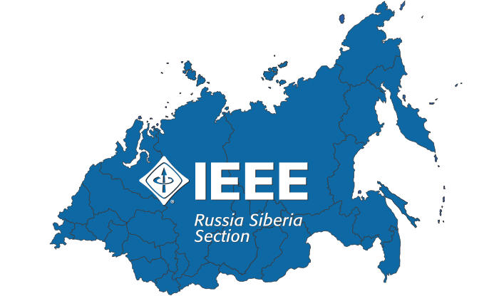
{: .nonprofit}

## Keynote

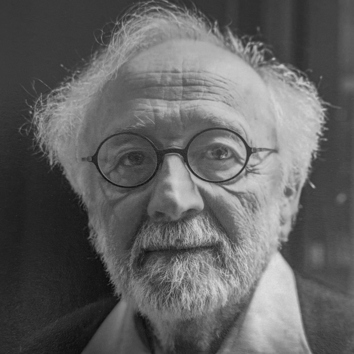{: width="92" height="92"}
[Patrick Cousot](https://scholar.google.com/citations?user=mhlvI8wAAAAJ)
 
[Courant Institute, NY University](https://cims.nyu.edu/dynamic/)
 
Prof. Cousot holds the Silver Professorship at the [Courant Institute of Mathematical Sciences](https://cims.nyu.edu/),
  having previously held a chair at [École Normale Supérieure](https://www.ens.psl.eu/).
Together with [Radhia Cousot](https://en.wikipedia.org/wiki/Radhia_Cousot),
  he originated [abstract interpretation](https://en.wikipedia.org/wiki/Abstract_interpretation),
  a foundational theory of sound static program analysis.
He [received](https://awards.acm.org/award_winners/cousot_4651105)
  the [ACM SIGPLAN Programming Languages Achievement Award](https://www.sigplan.org/Awards/Achievement/) in 2013,
  the [IEEE John von Neumann Medal](https://corporate-awards.ieee.org/award/ieee-john-von-neumann-medal/) in 2018,
  and is an [ACM Fellow](https://awards.acm.org/award_winners/cousot_4651105).
He authored [Principles of Abstract Interpretation](https://mitpress.mit.edu/9780262044905/principles-of-abstract-interpretation/) (MIT Press, 2021)
  and publishes regularly in [POPL](https://popl.sigplan.org/) and [PLDI](https://pldi-conferences.org/).
{: .keynote}

**A More Abstract Abstract Interpreter**
{: .accepted}

Modern static analyzers are made of a structural (sometimes called
compositional) abstract interpreter (which proceeds by induction on the program
abstract syntax) and a abstract domain (defining program properties and
transformers for basic commands). The structure facilitates soundness proofs, in
that the program semantics is an instance of the abstract interpreter, it can be
proved once for all than an abstraction of the abstract interpreter is another
instance of this abstract interpreter, so that the proofs of soundness of a
static analysis reduce to that of the abstract domain with respect to the domain
of the semantics.
In "The Best of Abstract Interpretations" (POPL 2024), Giacobazzi and Ranzato
proved that this structuration of the static analysis cannot deliver the best
(most precise) possible program analysis (even when the abstract domain is the
best abstraction of the semantic domain, i.e. most precise sound abstraction
of the semantic domain defined by a given abstraction function).
We show that the problem simply disappears when we consider the correct structural
abstract interpreter, in particular a more abstract abstract interpreter.
{: .abstract}

<!--
## Steering Committee # {#steering}

To be determined...
{: .firebrick}
-->

## Program Committee # {#pc}

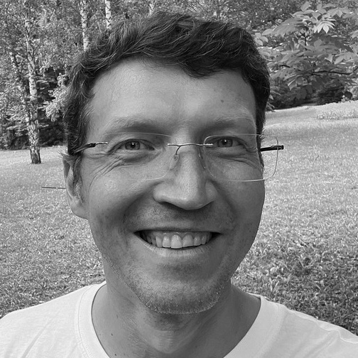{: width="92" height="92"}
[Vladimir Ivanov](https://scholar.google.com/citations?user=16AyxX0AAAAJ) (Chair)
 
[Innopolis University](https://innopolis.university/en/)
{: .pc}

And in alphabetical order:
{: .clear}

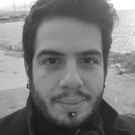{: width="92" height="92"}
[Anastasios Antoniadis](https://scholar.google.com/citations?user=5FT9RuEAAAAJ)
 
[University of Athens](https://en.uoa.gr/)<!--, Greece -->
{: .pc}

{: width="92" height="92"}
[Alexandre Bergel](https://scholar.google.com/citations?user=5pG4GQ8AAAAJ)
 
[University of Chile](https://www.uchile.cl)
{: .pc}

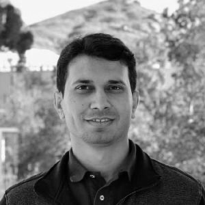{: width="92" height="92"}
[Umar Farooq](https://scholar.google.com/citations?user=QsWn-r8AAAAJ)
 
[UCR](https://www.ucr.edu/)
{: .pc}

{: width="92" height="92"}
[Jérôme Feret](https://scholar.google.com/citations?user=oWsrtiUAAAAJ)
 
[Inria](https://www.inria.fr/en)
{: .pc}

{: width="92" height="92"}
[Eduardo Fernandes](https://scholar.google.com/citations?user=bPnuCiMAAAAJ)
 
[University of Southern Denmark](https://portal.findresearcher.sdu.dk/en/organisations/sdu-software-engineering)
{: .pc}

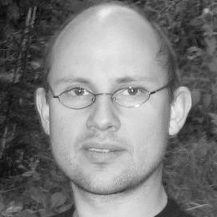{: width="92" height="92"}
[Bjoern Franke](https://scholar.google.com/citations?user=Y6aTqRQAAAAJ)
 
[University of Edinburgh](https://www.ed.ac.uk/)
{: .pc}

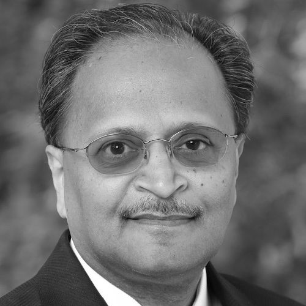{: width="92" height="92"}
[Rajiv Gupta](https://scholar.google.com/citations?user=6P4bGWAAAAAJ)
 
[University of California, Riverside](https://www.ucr.edu/)
{: .pc}

{: width="92" height="92"}
[Dongjie He](https://scholar.google.com/citations?user=tbbZPRAAAAAJ)
 
[Chongqing University](https://english.cqu.edu.cn/)
{: .pc}

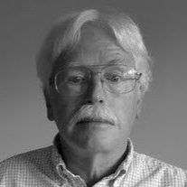{: width="92" height="92"}
[Doug Lea](https://scholar.google.com/citations?user=7yk1kw4AAAAJ)
 
[State Univ. of New York at Oswego](https://ww1.oswego.edu/)
 
[ACM Fellow](https://awards.acm.org/award_winners/lea_3428158)
{: .pc}

{: width="92" height="92"}
[David H. Lorenz](https://www.openu.ac.il/home/lorenz/)
 
[Open University of Israel](https://www.openu.ac.il/)
{: .pc}

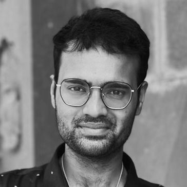{: width="92" height="92"}
[Umang Mathur](https://scholar.google.co.in/citations?user=6rB8UjgAAAAJ)
 
[National University of Singapore](https://www.nus.edu.sg/)
{: .pc}

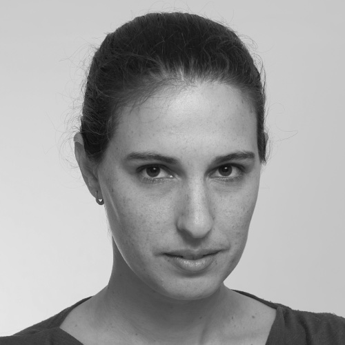{: width="92" height="92"}
[Hila Peleg](https://scholar.google.com/citations?user=rA33JTIAAAAJ)
 
[Technion](https://www.technion.ac.il/en/)
{: .pc}

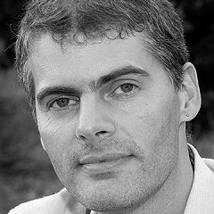{: width="92" height="92"}
[Benjamin C. Pierce](https://scholar.google.com/citations?user=2kkddh0AAAAJ)
 
[University of Pennsylvania](https://www.upenn.edu/)
 
[ACM Fellow](https://awards.acm.org/award_winners/pierce_4660460)
{: .pc}

{: width="92" height="92"}
[Taro Sekiyama](https://scholar.google.com/citations?user=zkiGvKQAAAAJ)
 
[National Institute of Informatics](https://www.nii.ac.jp/en/)
{: .pc}

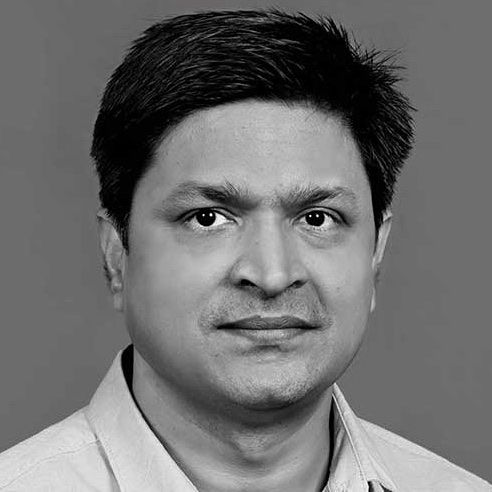{: width="92" height="92"}
[Abhishek Kr Singh](https://scholar.google.com/citations?user=ps296UkAAAAJ)
 
[IIIT Hyderabad](https://www.iiit.ac.in/)
{: .pc}

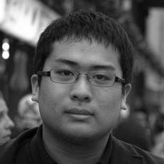{: width="92" height="92"}
[Yudai Tanabe](https://scholar.google.co.uk/citations?user=rFnRl1gAAAAJ)
 
[Tokyo Institute of Technology](https://www.titech.ac.jp/english/)
{: .pc}

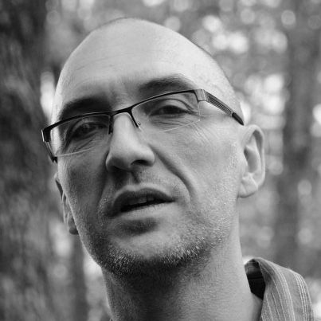{: width="92" height="92"}
[Didier Verna](https://scholar.google.fr/citations?user=O9G-pNoAAAAJ)
 
[EPITA](https://www.epita.fr)
{: .pc}

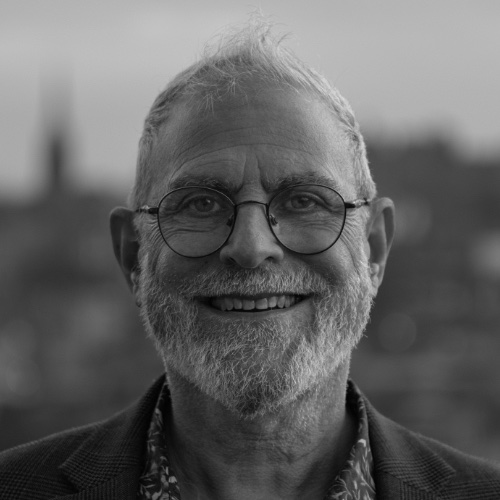{: width="92" height="92"}
[Philip Wadler](https://scholar.google.com/citations?user=Iz-3VFQAAAAJ)
 
[University of Edinburgh](https://www.ed.ac.uk/)
 
[ACM Fellow](https://awards.acm.org/award_winners/wadler_3048733)
{: .pc}

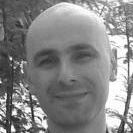{: width="92" height="92"}
[Enea Zaffanella](https://scholar.google.com/citations?user=iR7TigYAAAAJ)
 
[University of Parma](https://www.unipr.it/en)
{: .pc}

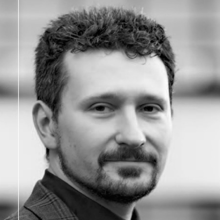{: width="92" height="92"}
[Vadim Zaytsev](https://scholar.google.com/citations?user=Ycwf7Z4AAAAJ)
 
[University of Twente](https://www.utwente.nl/en/)
{: .pc}

## Accepted Papers # {#papers}

We received 14 submissions.
No papers were desk rejected.
4 papers were accepted.
Each accepted paper received at least three reviews from PC members.

**Does AI-Assisted Development Accelerate Architectural Drift? A Large-Scale Study of C++ Repositories**
<!--  -->
<!--  -->
<!-- [0](https://www.semanticscholar.org/paper/4ba4a73a4e3030eadb944d4ffbd54c7dbc39a2f8){:.semanticscholar} -->
Sergey Blekher
{: .accepted}

Coding agents can generate software changes faster than
human reviewers can inspect them, raising the concern
that repository structure degrades faster under
AI-assisted development. We test this hypothesis in C++
by measuring architectural drift at commit level across
1,188 open-source repositories and 484,500 analyzed
commits, using a deterministic source-level analyzer
that replays history and records structural
regressions: new or grown include cycles, god headers,
cross-area dependencies, code clones,
cognitive-complexity growth, and self-admitted
technical debt. AI attribution relies only on
repository metadata, never on commit prose. A naive
pooled comparison suggests that AI-attributed commits
introduce substantially more complexity. This result
disappears after controlling for repository and commit
size: in a within-repository, size-matched analysis
over 344 repositories, we detect no drift category in
which AI-attributed commits are worse than human
commits. Attribution relies on visible markers, so the
human class contains unmarked AI use; under the
contamination we model, a true 2× per-commit penalty
would be observed as about 1.4×, and the sparse
structural categories have low power. The observable
difference is commit size: AI-attributed commits are
about 1.3× larger. In a preregistered adoption event
study covering 854 adopting repositories and 517
placebo controls, agent adoption is associated with
1.93× more drift events per week than in placebo
repositories observed in the same calendar weeks (95%
CI [1.42, 2.62]). Per commit the increase is 1.24×
([0.97, 1.58]) and per KLOC 1.14× ([0.96, 1.35]);
cognitive-complexity growth is the one endpoint that
also rises per unit of change (1.17× per commit, 1.14×
per KLOC). Merged pull requests rise 1.38× relative to
placebo, while human review comments per pull request
fall to 0.73×. Most of the post-adoption increase in
drift comes from more changes arriving, with a smaller
per-change rise in complexity; the number of human
review comments does not grow with the number of pull
requests.
{: .abstract}

**OSS-SOM: Open Source Software Survivability Ontology Model**
<!--  -->
<!--  -->
<!-- [0](https://www.semanticscholar.org/paper/4ba4a73a4e3030eadb944d4ffbd54c7dbc39a2f8){:.semanticscholar} -->
Olga Ataeva, Andrey Khalov, and Sergey Petrenko
{: .accepted}

We propose OSS-SOM, an ontological model that prepares
a test of the relation between code quality metrics and
the survivability factors of an open source software
product. By survivability we mean the capacity of a
product to continue its maintenance and evolution,
measured by survivability factors over successive
observation periods. The object of formalization is the
definition of a metric itself: its measurement scale,
the procedure that produces it, the kind of input data
it requires, and its derivability from other
quantities. We show that such a formalization makes the
operationalization of variables machine-checkable
before any data is collected: mathematical coupling
between variables—a source of spurious correlation—is
detected by a single query over the derivation graph
together with SHACL validation. The model is built on
W3C vocabularies and demonstrated on the code of the
Apache Log4j software. A knowledge graph of 10,610 RDF
triples has been constructed. Six pairs of coupled
variables (a source of spurious correlation) were
detected, two of them after a derivation edge missing
from the initial catalogue was added; the query reports
whether a pair is coupled by functional derivability or
by a common source. The demonstration is a proof of
concept, and the statistical test of the relation
between code quality and survivability is left to a
panel study whose analysis plan is outlined. The model,
the data and the queries are published as a
reproducible artifact, together with a replication
procedure.
{: .abstract}

**Fine-Tuning Small Language Models for Real-World Java Vulnerability Detection**
<!--  -->
<!--  -->
<!-- [0](https://www.semanticscholar.org/paper/4ba4a73a4e3030eadb944d4ffbd54c7dbc39a2f8){:.semanticscholar} -->
Norbert Sándor Szolnoki and Gábor Antal
{: .accepted}

Automated source code vulnerability detection remains
challenging because traditional static analysis tools
often struggle with context-aware reasoning and
generalization across software projects. Although large
language models have shown promising results, privacy
requirements and hardware limitations frequently
prevent organizations from using cloud-hosted or very
large models. This study investigates whether smaller
decoder-style language models can support method-level
Java vulnerability detection under realistic on-premise
resource constraints and whether parameter-efficient
fine-tuning improves their effectiveness. We
constructed a curated dataset of 380 vulnerable–fixed
Java method pairs, producing 760 labeled instances,
balanced by construction and associated with 216 CVEs
and 74 CWEs. Eighteen open-source models from the
Qwen2.5, DeepSeek, StarCoder2, Mistral, and Meta-LLaMA
families were evaluated using a unified prompt-based
binary classification framework. Vulnerable and fixed
counterparts were kept within the same grouped split to
reduce data leakage. Models were assessed in zero-shot
settings and after 4-bit QLoRA fine-tuning, with
fine-tuned results averaged across three runs with
different split seeds on a single 16 GB consumer GPU.
Fine-tuned F1 exceeded zero-shot F1 for 14 of the 18
models, with a mean difference of 0.056 across the
evaluated checkpoints. Average accuracy and precision
increased by 0.135 and 0.120, respectively, while
recall decreased by 0.090. These are descriptive
differences under within-corpus evaluation; the
evaluation paths do not use identical held-out samples.
The best configuration, Qwen2.5-Coder-14B-Instruct,
achieved an F1-score of 0.755. These results
characterize the potential and precision–recall
trade-offs of fine-tuned small decoder models for
privacy-sensitive, locally deployed vulnerability
analysis.
{: .abstract}

**Measured Acceptance and Rollback as a Quality Gate for Agent-Generated SQL**
<!--  -->
<!--  -->
<!-- [0](https://www.semanticscholar.org/paper/4ba4a73a4e3030eadb944d4ffbd54c7dbc39a2f8){:.semanticscholar} -->
Maksim Radionov, Pavel Stepanov, Nikita Moskovchuk, Daria Lavitskaya, Andrej Balles, and Alexandra Shumailova
{: .accepted}

Coding agents now write code that reaches production,
and there is no settled discipline for deciding whether
such code stays. We used measured acceptance and
rollback to guide that decision. An agent driven by a
large language model developed a seventeen-step
pipeline that turns natural-language questions into SQL
queries over relational databases. Humans designed the
surrounding harness and wrote none of the pipeline. The
harness records what every step saw and decided, scores
each generated query by executing it and comparing its
rows against a reference answer, and classifies the
row-level differences, so recurring defects can be
mined from run records. Every proposed step was
admitted on one criterion, its measured effect on the
quality of the emitted SQL, and steps whose gains did
not survive later runs were rolled back. The resulting
pipeline raised accuracy from 70.9% for a single call
to the same model to 76.2% on the development set and
81.3% on the private test set. Run unchanged with two
other generating models, an earlier version of the same
model and a model from a different developer, the
pipeline raised both, by 3.2 and 6.7 points, so its
steps capture properties of the task rather than habits
of one model. Measured acceptance and rollback is a
workable quality gate for code no human authored.
{: .abstract}

## Program / Agenda # {#program}

Watch us [live on YouTube](https://youtube.com/live/NiXLO1P1y34).

16:00 ([Moscow time](https://en.wikipedia.org/wiki/Moscow_Time))
 
[Vladimir Ivanov](https://scholar.google.com/citations?user=16AyxX0AAAAJ):
Opening
{: .agenda .agenda-10 .agenda-welcome}

16:10
<!--  -->
 
[Patrick Cousot](https://scholar.google.com/citations?user=mhlvI8wAAAAJ): 
A More Abstract Abstract Interpreter
{: .agenda .agenda-45 .agenda-keynote}

17:00
<!--  -->
 
Sergey Blekher: 
Does AI-Assisted Development Accelerate Architectural Drift? A Large-Scale Study of C++ Repositories
{: .agenda .agenda-20 .agenda-regular}

17:20
<!--  -->
 
Olga Ataeva: 
OSS-SOM: Open Source Software Survivability Ontology Model
{: .agenda .agenda-20 .agenda-regular}

17:40
<!--  -->
 
Norbert Sándor Szolnoki: 
Fine-Tuning Small Language Models for Real-World Java Vulnerability Detection 
{: .agenda .agenda-20 .agenda-regular}

18:00
<!--  -->
 
Maksim Radionov: 
Measured Acceptance and Rollback as a Quality Gate for Agent-Generated SQL 
{: .agenda .agenda-20 .agenda-regular}

18:20
Closing
{: .agenda .agenda-10 .agenda-welcome}

## Partners # {#partners}

[A.P. Ershov Institute of Informatics Systems](https://www.iis.nsk.su/en)
{: .partner}

[Innopolis University](https://innopolis.university/)
{: .partner .xxl}

[Higher School of Economics](https://www.hse.ru/en/)
{: .partner}

[St. Petersburg University](https://english.spbu.ru)
{: .partner .xxl}

## Organizers # {#organizers}

These people are making ICCQ 2026:

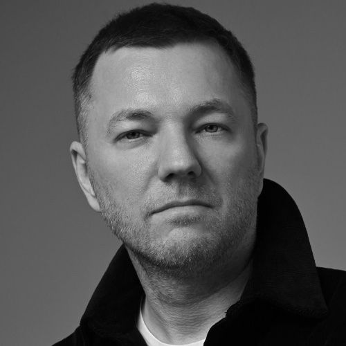{: width="92" height="92"}
[Yegor Bugayenko](https://www.yegor256.com/about-me.html) (Chair)
{: .org}

{: width="92" height="92"}
[Sergey Belov](https://www.linkedin.com/in/sebelov/)
{: .org}

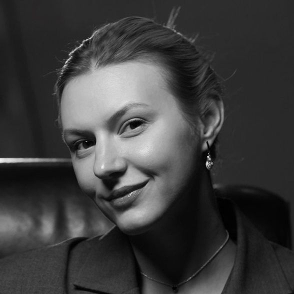{: width="92" height="92"}
[Maria Eliseeva](https://www.linkedin.com/in/maria-eliseeva-evgenevna/)
{: .org}

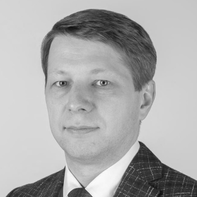{: width="92" height="92"}
[Andrey Palyanov](https://scholar.google.com/citations?user=FTEi6TYAAAAJ)
{: .org}

## Registration # {#registration}

The conference will be streamed live
on [our YouTube channel][youtube] and you
will be able to watch it without registration.
However, registration is mandatory if you want to attend the event
and enjoy a tasty lunch with some of our speakers.

Registration is free of charge.

[youtube]: https://www.youtube.com/channel/UC_W-pjp6HWJGjK2sayFrnag
[double-blind]: https://www.elsevier.com/en-gb/reviewer/what-is-peer-review/guidelines
[WoS]: https://clarivate.com/webofsciencegroup/solutions/web-of-science/
[PDF version]: https://github.com/yegor256/iccq.github.io/blob/pdf/iccq-cfp-2026.pdf
[cfp@iccq.ru]: mailto:cfp@iccq.ru
[easychair]: https://easychair.org/cfp/ICCQ26
